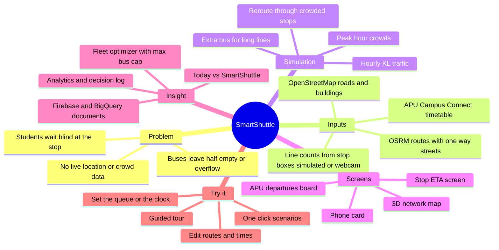

# SmartShuttle

**Crowd-aware buses, smart queues and live ETAs for every APU student.**
A 3D simulation of Asia Pacific University's *Campus Connect* shuttle network — built for the **APU Cloud Innovation Hackathon 2026 (Problem 01 · Smart Campus)** by team **Buset**.

> **Status: hackathon prototype · version 0.1.0 (unreleased).** Everything you see is **simulated**: buses, queues and traffic are modelled on APU's real published timetable and real roads, not live data. Not a production system.
>
> Documentation by **Webtinous · by Continous Group** — [Project Standards v6.0.0](webtinousQA/webtinousstandard.md).

[Core functions](#core-functions) · [Quick start](#quick-start) · [Installation and configuration](#installation-and-configuration) · [Usage](#usage) · [Documentation and development](#documentation-and-development) · [Versions and changes](#versions-and-changes) · [Help, contribution and rights](#help-contribution-and-rights)

## How the idea works



*Mind map of the workflow. Editable source: [`workflow-mindmap.mmd`](webtinousQA/maps/workflow-mindmap.mmd) · all maps: [maps index](webtinousQA/maps/README.md). The Mermaid block above renders on GitHub; it was not render-checked in this repository (see [evidence](webtinousQA/evidence/verification-2026-11-12.md)).*

## Core functions

| Function | What it gives you |
| --- | --- |
| **3D network map** | Nine real APU shuttle routes drawn on real roads and buildings, with buses driving them. Drag to rotate, scroll to zoom, click a stop or bus to follow it. |
| **APU's real timetable** | Every trip of the published weekday schedule (effective 22 Oct 2026), including the LRT's continuous 7:30–8:45 morning pattern and "limited space" late trips. |
| **Smart queue and ETA screens** | A stop screen (next bus, people in line, status) for each stop and a departures board at APU; click any **In line** number to set how many people are waiting. |
| **Crowd-aware dispatch** | A spare bus is called when a line is longer than one bus; a bus with free seats can pull in at another route's crowded stop on its road. Every decision shows its numbers in the **Logic** tab. |
| **Today vs SmartShuttle** | The same weekday run twice — as APU runs it now and with SmartShuttle — for normal, exam-week, rain, stadium-event and LRT-delay days. |
| **Fleet optimizer** | Finds the fewest buses per route that still run every trip on time, optionally under a **max buses** cap. |
| **Data for planning** | Analytics (buses deployed, waits, on-time, load) and Firebase-style documents in the team's BigQuery schema, with an **Export JSON** button. |
| **Webcam stop box, phone view, guided tour** | A laptop-webcam person counter for a stop's line, a phone card that follows the demo live, and a driver.js tour of the whole idea. |

**Current limitations:** UniStay @ Kingston and Bayu Jalil are on APU's timetable but not mapped yet. Fleet sizes are assumptions. Traffic and crowds follow modelled hourly profiles. The webcam stop box and Firebase live sync have **not** been verified on a real camera or a real Firebase project — see [known limits](webtinousQA/README.md#current-findings-and-limits).

## Quick start

Prerequisites: **Node.js 20 or newer** and **pnpm** (developed with Node 25.6 and pnpm 11.17). Run from the repository root:

```bash
pnpm install
pnpm dev
```

Open **http://localhost:5173**. A guided tour starts on your first visit (press **?** to replay it). Click **60×** under the map panel to watch a rush hour in a minute.

**Expected result:** a tilted 3D map of the area between Bukit Jalil LRT and APU, coloured routes, buses driving them, and a panel on the right with the APU departures board.

## Installation and configuration

| Task | Command | Result |
| --- | --- | --- |
| Install dependencies | `pnpm install` | Installs from `pnpm-lock.yaml`. |
| Development server | `pnpm dev` | http://localhost:5173 with hot reload. |
| Run the checks | `pnpm test` | 16 test files, 102 tests (passed on 2026-11-12). |
| Production build | `pnpm build` | Static site in `dist/` (main app + `phone.html`). |
| Serve the build | `pnpm preview` | http://localhost:4173 — what a static host would serve. |

The built site is fully static and needs no server of its own. Two features use the internet at run time: the **webcam stop box** downloads its person-detection model, and **Firebase live sync** talks to your Firebase project.

**Optional configuration** (all names in [`.env.example`](.env.example), safe placeholder values only; copy it to `.env.local`, which git ignores):

| Name | Purpose |
| --- | --- |
| `VITE_FIREBASE_API_KEY`, `VITE_FIREBASE_AUTH_DOMAIN`, `VITE_FIREBASE_PROJECT_ID`, `VITE_FIREBASE_APP_ID` | Turn on live sync of the current state to Firestore, so the phone view works on other devices. Leave unset to run offline. |
| `VITE_FIRESTORE_EMULATOR` | Optional `host:port` of a local Firestore emulator. |

Refreshing the map data needs the internet (OpenStreetMap Overpass and the OSRM demo server): `pnpm bake:routes` then `pnpm bake`. Details: [DEVELOPMENT.md](webtinousQA/documentation/DEVELOPMENT.md).

## Usage

| I want to… | Do this |
| --- | --- |
| See the whole network | Press **Overview** (Live tab), or reload. |
| Jump to a time of day | Click the **clock** in the top-right corner of the map (06:30–22:30). |
| Change how many people wait | Click an **In line** number, type 0–999, press **Set**. |
| Try a different kind of day | Pick **Exam week**, **Heavy rain**, **Stadium event** or **LRT delay** on the Live tab. |
| Prove the impact | **Impact** tab → **Run comparison** (or **Compare all days**). |
| Find the best fleet | **Analytics** tab → set **Max buses** → **Optimize** → **Apply to routes**. |
| See why a bus was called or rerouted | **Logic** tab → *Latest decisions*. |
| Retune a route | **Edit** tab → change times, buses or seats, or switch the route off (saved in this browser; **Reset** restores APU's schedule). |
| Use your webcam as a stop box | **Camera stop box** → allow the camera → step into view. Only the count is used; no images are stored or sent. |
| Follow on a phone view | **Phone view** → open the link beside the demo (same browser) or scan the QR code once Firebase is configured. |

Rules, formulas and assumptions behind each behaviour: [RULES.md](webtinousQA/documentation/RULES.md).

## Documentation and development

- **Developers and assistants must read the Webtinous starting guide first:** [`webtinousQA/webtinousstandard.md`](webtinousQA/webtinousstandard.md), then the [QA index](webtinousQA/README.md).
- Architecture and trust boundaries: [ARCHITECTURE.md](webtinousQA/documentation/ARCHITECTURE.md) · Data and schemas: [DATA.md](webtinousQA/documentation/DATA.md) · Maps and mind maps: [maps](webtinousQA/maps/README.md) · Decisions: [decisions](webtinousQA/decisions/README.md).
- Verification evidence: [evidence record](webtinousQA/evidence/verification-2026-11-12.md) · Impact results: [impact comparison](webtinousQA/reports/impact-comparison.md) (regenerate with `pnpm report:impact`).
- The original design and implementation plan are kept as history in [`docs/superpowers/`](docs/superpowers/).

## Versions and changes

Current version: **0.1.0**, defined by `package.json`. **No release, tag or GitHub release has been published yet.** What is built so far is listed under *Unreleased* in the [CHANGELOG](webtinousQA/documentation/CHANGELOG.md); day-by-day progress is in the [UPDATELOG](webtinousQA/documentation/UPDATELOG.md). The work lives on the `feat/3d-map` branch.

## Help, contribution and rights

- **Help and issues:** use the GitHub repository [Earth177777/SmartBus-Shuttle](https://github.com/Earth177777/SmartBus-Shuttle) (currently private — ask the team for access).
- **Contributing:** work on a branch and merge only with the team's agreement; run `pnpm test` before pushing; keep [CHANGELOG](webtinousQA/documentation/CHANGELOG.md) and [UPDATELOG](webtinousQA/documentation/UPDATELOG.md) current.
- **Team (Buset):** Gilbert, Herbert Valentino, Louis, Nicholas.
- **License:** none has been chosen yet, so no permission to reuse the code is granted beyond the team's own use. The team should pick one before sharing publicly.
- **Third-party rights and notices:**

| Material | Terms |
| --- | --- |
| Map data © OpenStreetMap contributors | [ODbL 1.0](https://www.openstreetmap.org/copyright) — attribution is shown in the app. Routes by [OSRM](https://project-osrm.org/) over OSM data. |
| APU Campus Connect timetable, route names and prices | © Asia Pacific University of Technology & Innovation, taken from its public pages; used here for a hackathon demo. This project is not affiliated with or endorsed by APU. |
| three.js, driver.js, qrcode, Hugeicons (free), Vite, Vitest | MIT |
| Firebase SDK, TensorFlow.js, COCO-SSD | Apache-2.0 |

**Logo:** no approved SmartShuttle logo has been supplied, so this README uses the text wordmark as an accepted fallback.

---

**Webtinous · by Continous Group** — documentation structure follows Project Standards v6.0.0 ([MD.MD](webtinousQA/standards/MD.MD)). Attribution does not imply security review, certification or production readiness.
