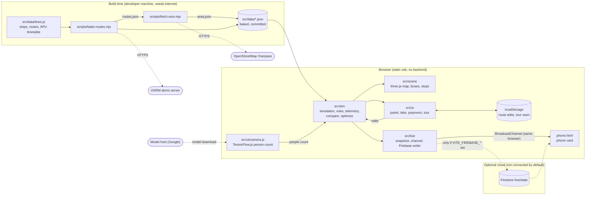

# Architecture

> **Webtinous · by Continous Group** — documentation. Hand-maintained; reflects the code at the revision in the [evidence record](../evidence/verification-2026-11-12.md). Back to the [QA index](../README.md).

**Evidence labels used here:** *Source-confirmed* = traced to the inspected code (not proof it ran in production) · *Test-confirmed* = a named automated test passed · *Derived* = produced by a reproducible script · *Inferred* = reasoned, assumption stated · *Documented intent* = a goal, not current behaviour · *Not verified*.

## Overview

SmartShuttle is a **static single-page web app** (plus one extra page, `phone.html`). There is **no backend** of our own. All behaviour — the simulation, rules, analytics and the 3D scene — runs in the visitor's browser from data files baked into the repository. *Source-confirmed.*

*Notation: Mermaid flowchart with labelled boundaries. Source: [architecture-components.mmd](../maps/architecture-components.mmd). Legend and limits: [maps index](../maps/README.md).*

## Components

| Component | Responsibility | Key files | Evidence |
| --- | --- | --- | --- |
| **Route and timetable config** | The 11 stops, 9 routes, APU's weekday timetable, pickup order, fleet and seat assumptions. Single source for both the bake scripts and the app. | `src/data/lines.js` | Source-confirmed; timetable counts Test-confirmed (`tests/schedule.test.js`) |
| **Bake scripts** | Fetch real driving routes (OSRM, one-way aware) and surrounding OpenStreetMap streets/buildings once, write JSON. Run by a developer, never at run time. | `scripts/bake-routes.mjs`, `scripts/fetch-osm.mjs` | Source-confirmed; outputs are committed data |
| **Simulation** | Advances a service day: arrivals, buses, dispatch, extra buses, rerouting, telemetry. Pure functions over a state object — no DOM — so it is unit-tested. | `src/sim/sim.js`, `bus.js`, `polyline.js`, `reroute.js`, `traffic.js`, `demand.js`, `scenarios.js`, `schedule.js`, `telemetry.js` | Test-confirmed (see [evidence](../evidence/verification-2026-11-12.md)) |
| **Analytics engines** | Replay whole days: *Today vs SmartShuttle*, the fleet optimizer, and the impact report. | `src/sim/compare.js`, `src/sim/optimize.js`, `scripts/impact-report.mjs` | Test-confirmed; report Derived |
| **3D scene** | Draws buildings, roads, route ribbons, buses (size scales with zoom) and stop pins with queue figures. Reads simulation state each frame. | `src/scene/*` | Source-confirmed; visually checked in the Browser pane on 2026-11-12 (not a formal test) |
| **Panel and tabs** | Live, Impact, Logic, Analytics, Firebase, Edit; click-to-edit popovers; map clock; guided tour. | `src/ui/*`, `src/main.js` | Source-confirmed; exercised manually in the Browser pane |
| **Live outputs** | Builds a plain-JSON snapshot every second, sends it over a same-browser `BroadcastChannel` to `phone.html`, and (only if configured) writes it to Firestore. | `src/live/*`, `src/phone.js` | Same-browser feed Source-confirmed and observed once; Firebase path **Not verified** |
| **Webcam stop box** | Opens the camera, counts people on-device with COCO-SSD, feeds the count into a stop's queue. | `src/ui/camera.js`, `src/sim/camera-count.js` | Counting logic Test-confirmed; camera and detector **Not verified on a real camera** |

## Data ownership

| Data | Owner / writer | Readers | Lifetime |
| --- | --- | --- | --- |
| Timetable, stops, fleet assumptions | `src/data/lines.js` (committed) | bake scripts, simulation, panel | Until edited in git |
| Baked routes and map (`routes.json`, `area.json`) | Bake scripts (Derived) | simulation, scene | Until re-baked |
| Simulation state (queues, buses, telemetry, decisions) | The running page | panel, scene, live outputs | The page visit; replayed when the clock is changed or an edit is applied |
| Route edits (times, fleet, seats, on/off) | The visitor, via the Edit tab | simulation | `localStorage` key `smartshuttle.overrides.v1` in that browser |
| "Tour seen" flag | The tour | tour | `localStorage` key `smartshuttle.tourSeen.v1` |
| Last phone-view stop | `phone.html` | `phone.html` | `localStorage` key `smartshuttle.phoneStop.v1` |
| `live/state` document | The demo page (when Firebase is configured) | `phone.html` | Overwritten every ~2 s; **Not verified** |

## Trust boundaries and security notes

*Source-confirmed unless marked.*

- **No accounts, no server, no secrets in the repository.** A scan of tracked files for key-like strings found none (2026-11-12). Firebase settings are read from `VITE_FIREBASE_*` at build time; the template [`.env.example`](../../.env.example) holds placeholders only and real `.env*` files are git-ignored.
- **Firebase web config is not a secret** by design, but access is only as safe as the project's Firestore rules. **No rules are included here and none were reviewed** — configure rules before connecting a real project. *Not verified.*
- **Webcam:** frames stay in the page; only an integer count is used. No frame is stored or sent by this code. The model weights are downloaded from a third-party host at run time (*Inferred* from the library's default loader; not observed because the Browser pane blocks the camera).
- **Student data:** the demo uses **synthetic, anonymous** identifiers (`anon-…`). It processes no real student identity. The pitch's face-matching check-in is **Documented intent**, not implemented.
- **Untrusted text:** values typed by the visitor (times, counts) are parsed and range-checked; text rendered into the panel is HTML-escaped. Route/stop names come from committed files.
- **Branded 404 / UI attribution:** the Webtinous identity (footer/About credit and 404) required by DESIGN.MD is **not yet implemented in the product UI**. The site has no client-side routing, so a missing path would show the host's own 404. Recorded as a gap in the [QA index](../README.md#current-findings-and-limits).

## Failure behaviour

| Situation | Behaviour | Evidence |
| --- | --- | --- |
| Camera blocked or absent | Card shows "Camera blocked — allow camera access…"; the rest of the demo is unaffected | Observed in the Browser pane |
| `localStorage` unavailable | Edits last for the visit only; no crash | Source-confirmed (`try/catch` around every access) |
| Firebase not configured | Live sync stays off silently; phone view still works in the same browser | Source-confirmed |
| Firebase write fails | The writer records the error and retries on the next tick; the demo continues | Source-confirmed; Not verified against Firestore |
| Browser tab hidden | The simulation step is capped to 0.25 s of real time per frame so it does not jump ahead | Source-confirmed |
| Two stops on a route cannot be connected by road | Not applicable at run time — routes are baked; a failed bake stops with an error | Source-confirmed |
