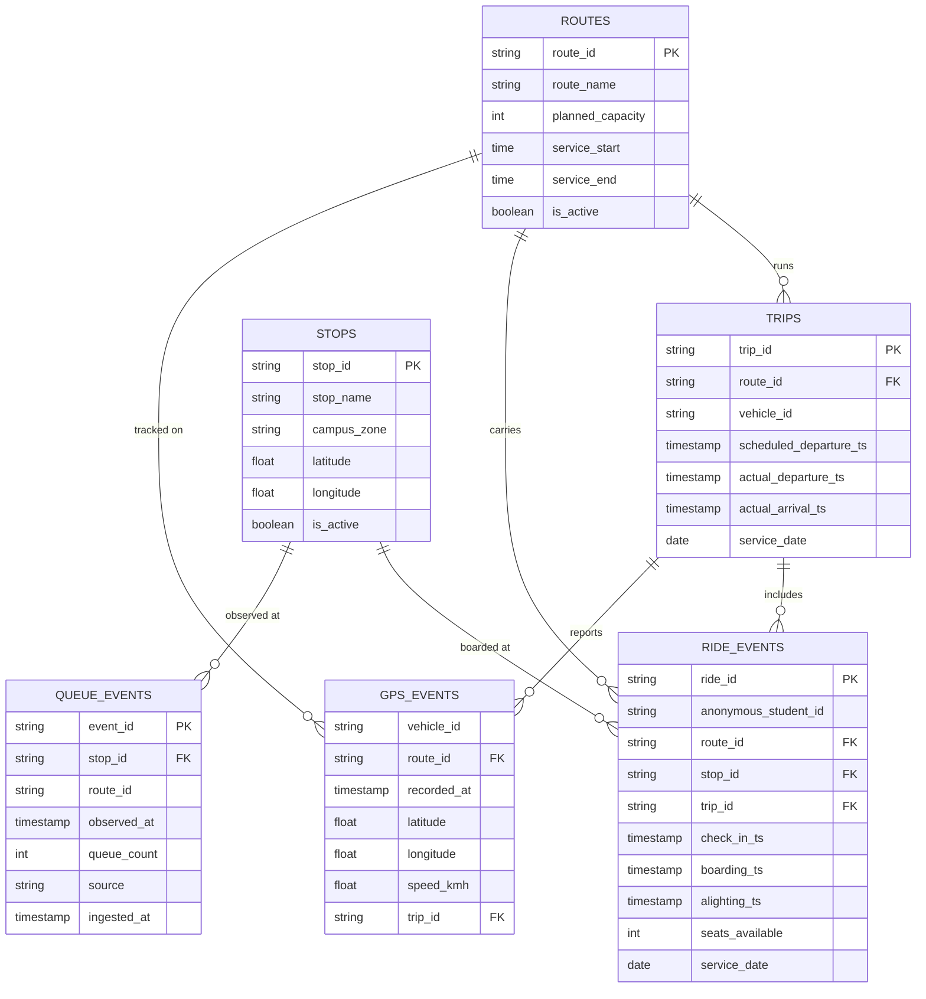

# Data, schemas and identifiers

> **Webtinous · by Continous Group** — documentation. Hand-maintained; describes the repository at the revision in the [evidence record](../evidence/verification-2026-11-12.md). Back to the [QA index](../README.md).

There is **no database** in this repository. Data is (1) baked JSON files, (2) in-memory simulation state, (3) telemetry documents the simulation produces in the shape of the team's BigQuery tables, and (4) a few browser storage keys. Evidence labels as in [ARCHITECTURE.md](ARCHITECTURE.md).

## Baked files (Derived)

| File | Content | Produced by | Refresh |
| --- | --- | --- | --- |
| `src/data/routes.json` | Stops (local metre coordinates) and, per route, the real driving path of each leg in both directions: points, cumulative free-flow seconds (from OSRM annotations), distance, duration, road names. | `scripts/bake-routes.mjs` ← OSRM `router.project-osrm.org`, using the stops and via-points in `src/data/lines.js` | `pnpm bake:routes` |
| `src/data/area.json` | ~3,500 buildings (footprint + height) and ~7,350 road ways (OpenStreetMap "ways") covering the whole network plus streets around APU and each stop. | `scripts/fetch-osm.mjs` ← OpenStreetMap Overpass (3 mirrors tried) | `pnpm bake` (after `bake:routes`) |
| `src/data/lines.js` | **Hand-maintained** stops, routes, timetable (from APU's PDF), pickup order, fleet and seats. | A person | Edit, then re-bake |

**Coordinates.** All geometry is a flat local projection around APU (`lat 3.0553, lon 101.7006` = origin; +x east, +z south, 1 unit = 1 m), implemented in `src/geo.js` (`project` / `unproject`). It is fine for a ~12 km area; it is not a survey-grade projection. *Test-confirmed:* `tests/geo.test.js`.

**Identifiers.** Route and stop IDs are lowercase slugs (`lrt`, `parkhill`, `kuchai_sentral`…); the APU departures board uses the queue key `apu:<routeId>` for the line of people at APU waiting for that route. They are internal routing keys: they authorise nothing.

**Licences of derived data.** `area.json` and the road geometry in `routes.json` are © OpenStreetMap contributors under ODbL 1.0 (attribution is shown in the app). Timetable, route names and prices are APU's public information. See the [README](../../README.md#help-contribution-and-rights).

**Known data limits.** UniStay @ Kingston and Bayu Jalil are on APU's timetable but could not be located in OpenStreetMap, so they are not mapped. The Parkhill stop is placed at the front gate on Susur Jalil Sejahtera (OpenStreetMap lift-gate nodes), because the bus does not use the Jalan Teknologi 2 back lane. The routing graph is OSRM's, so one-way streets are respected. Re-baking depends on the public OSRM demo server, which may rate-limit.

## Simulation state (in memory)

Created by `createSim()` in `src/sim/sim.js`. Source-confirmed fields:

| Field | Meaning |
| --- | --- |
| `clock`, `running`, `scenario`, `smart` | Seconds since midnight; whether service is open; the active scenario; which SmartShuttle features are on (used for *Today vs SmartShuttle*). |
| `lines[routeId]` | Config, today's departures (each with `served`, `lateSec`), baked legs, and the peak arrival rates. |
| `queues[key]` | `queue` (people waiting), `arrivals` (check-in times), plus bookkeeping. Keys: a stop id or `apu:<routeId>`. |
| `buses[]` | State (`idle` / `driving` / `dwelling`), load, seats, current trip, planned legs, any active detour. |
| `decisions[]`, `alerts[]` | The last 30 decisions with their numbers; alerts shown on stop screens. |
| `stats`, `telemetry` | Counters and the telemetry store below. |

The state is **discarded and rebuilt** whenever the clock is changed, a scenario is picked, a route is edited or **Restart** is used — the day is replayed from 06:30 to the chosen time with a new random seed.

## Telemetry collections

The simulation writes documents with the field names of the team's BigQuery dataset `smartshuttle` (screenshots of the table schemas were shared on 2026-11-10). Only the **latest 50** of each are kept in memory; **totals** are kept for all. *Test-confirmed:* `tests/telemetry.test.js` (field order and meaning).

*Notation: **Crow's Foot** logical schema (Mermaid `erDiagram`) — not Chen; see [decision D-09](../decisions/README.md). `||` exactly one, `o{` zero or many. Source: [data-model-crowsfoot.mmd](../maps/data-model-crowsfoot.mmd). The relationships are **Documented intent** from the team's ER diagram; nothing in this repository enforces them. `ROUTES` and `STOPS` are **not written** by the simulation (they come from the baked files).*

| Collection | Written when | Notes |
| --- | --- | --- |
| `queue_events` | Every **60 s** of simulated time, for every line (each stop, and each route's line at APU) | `source` = `stop_box_sim`; `ingested_at` is 2 s after `observed_at`. Includes `route_id`, which was **not** in the team's table screenshot (see the maps index *Unknowns*). |
| `ride_events` | Every boarding | `anonymous_student_id` is a synthetic `anon-…` counter; `check_in_ts` → `boarding_ts` is the real simulated wait; `alighting_ts` is filled when the rider gets off. |
| `gps_events` | Every **30 s** per bus that is driving | Latitude/longitude un-projected from the bus's path position; no `gps_id` (the team's table also has none). |
| `trips` | Every departure, including extra buses | `trip_id` like `lrt-out-0730`; `actual_*` filled as the trip proceeds. |

**Timestamps** are ISO-8601 with the Malaysia offset, e.g. `2026-11-13T07:30:05+08:00` (`tsISO` in `src/sim/telemetry.js`).

**Privacy.** The demo has **no real student data**; every identifier is synthetic. If real check-ins are ever added, the pitch's rules (consent once in APSpace, no photos stored, counts and IDs only) must be implemented and reviewed first — they are *Documented intent*, not built.

**Export.** The Firebase tab's **Export JSON** downloads the totals and the latest 50 documents per collection (`smartshuttle-firebase-2026-11-13.json`). Nothing is written to Firestore except the live snapshot described below.

## Live snapshot (`live/state`)

A plain JSON object built by `src/live/snapshot.js` every second: clock, scenario, traffic factor, every stop's screen (`nextTime`, `nextBusMin`, `inLine`, `status`, `alert`, …) and the APU board. It is sent over `BroadcastChannel('smartshuttle-live')` to `phone.html`, and — only when `VITE_FIREBASE_*` is set — written to the Firestore document `live/state` at most every 2 s. *Test-confirmed:* the snapshot's JSON shape (`tests/live.test.js`). The Firestore write and the Firestore read in `phone.html` are **Not verified** against a real project or emulator.

## Browser storage keys

| Key | Holds | Cleared by |
| --- | --- | --- |
| `smartshuttle.overrides.v1` | Route edits (times, fleet, seats, on/off) | **Reset all** in the Edit tab, or clearing site data |
| `smartshuttle.tourSeen.v1` | `"1"` once the tour has been shown | Clearing site data |
| `smartshuttle.phoneStop.v1` | The stop chosen on the phone view | Clearing site data |

Storage is optional: if the browser blocks it, everything still works for that visit.
