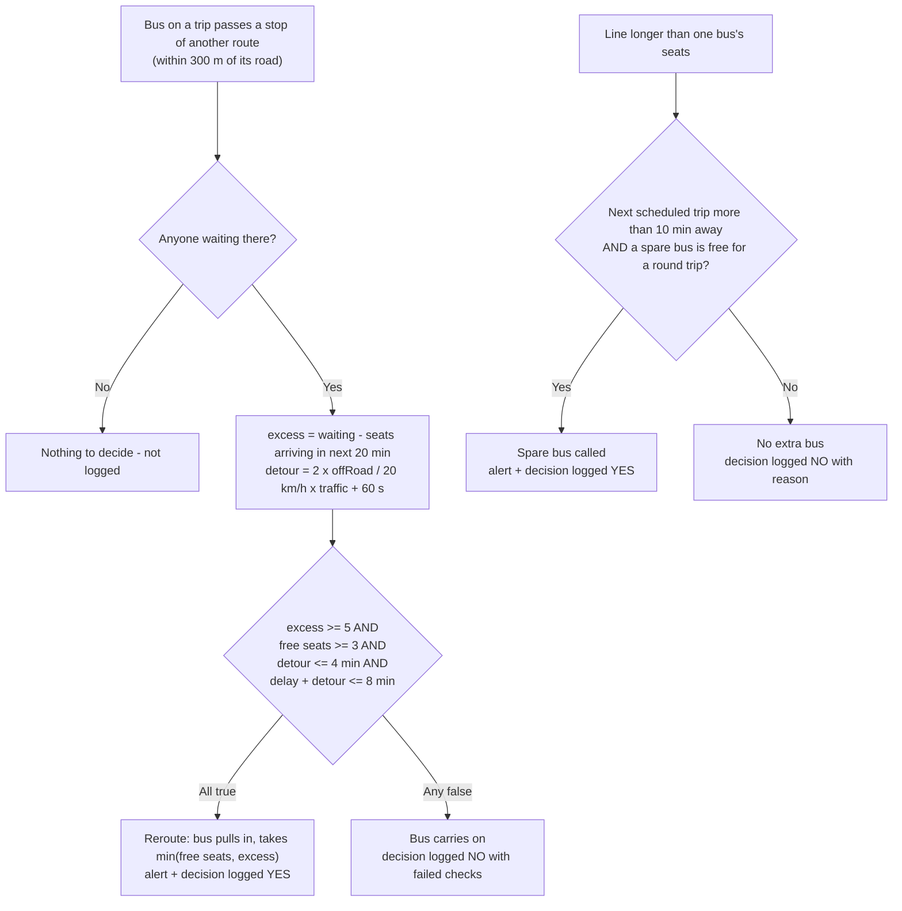

# Rules, formulas and assumptions

> **Webtinous · by Continous Group** — documentation. Hand-maintained; describes **implemented** behaviour at the revision in the [evidence record](../evidence/verification-2026-11-12.md). Back to the [QA index](../README.md).

Each rule has a stable ID. **Evidence** names the automated tests that check it (*Test-confirmed* = those tests passed on 2026-11-12) or says what was only read in the code (*Source-confirmed*). Values marked **assumption** are modelling choices, not APU facts. Pitch references are to the team's deck *APU SmartShuttle — Cloud Innovation Hackathon 2026* (a PDF kept by the team, **not** stored in this repository) — **Documented intent** unless a rule says it is built.

## Time, timetable and travel

| ID | Rule | Evidence |
| --- | --- | --- |
| **R-01** | The simulated day is a **weekday, 06:30–22:30** (service date `2026-11-13`, a Friday). Stops show **Offline** once a route has no trips left. | Test-confirmed: `tests/sim.test.js` ("starts at 06:30…", "shows Offline once a stop has no more trips today", "stops at the end of service") |
| **R-02** | Every trip of APU's Campus Connect schedule *V1_20261022* runs at its published time (e.g. LRT→APU 40 trips, APU→LRT 39). The LRT's 7:30–8:45 "continuous pattern" is modelled as an extra bus **every 6 minutes** (**assumption**). Trips marked `**` ("limited space") board at most **50%** of seats. A later pickup on a multi-stop route leaves its published offset after the first (Harmony +10 min). | Test-confirmed: `tests/schedule.test.js`; `tests/sim.test.js` ("serves every timetabled trip of the day, mostly on time") |
| **R-03** | Travel time = OSRM free-flow time × **traffic factor** × **scenario factor** × **1.15** (buses are slower than cars). A bus stops **60 s** at every stop. | Test-confirmed: `tests/bus.test.js`, `tests/traffic.test.js`, `tests/scenarios.test.js` ("a rainy morning makes the same trip take longer") |
| **R-04** | The traffic factor follows a modelled Kuala Lumpur weekday profile (**assumption**, not live data): 1.0 until 06:30, 1.4 at 07:00, **1.9 from 07:30 to 09:00**, 1.15 at 10:00–12:00, 1.3 at 12:30–14:00, 1.25 at 16:30, 1.8 at 17:00, **2.1 from 17:30 to 19:00**, 1.5 at 19:30, 1.2 at 20:30, 1.05 at 21:30, linear in between. Label: Light below 1.2, Moderate below 1.6, otherwise Heavy. | Test-confirmed: `tests/traffic.test.js` |

## Demand and queues

| ID | Rule | Evidence |
| --- | --- | --- |
| **R-05** | Each route's **peak** arrival rate is sized so a day's riders fill **60%** of the seats its timetable offers (**LRT 90%**) — **assumption**. Actual rate = peak × an hourly share: students go **to APU** mostly 07:00–09:00 and **home** mostly 11:00–13:00 and 16:30–18:30 (**assumption**, modelled on class times). | Test-confirmed: `tests/traffic.test.js` ("demandPerMinute (peak-hour system)") |
| **R-06** | Students do not wait hours: demand accumulates "at home" and people reach the stop evenly over the **20 minutes before** the next trip. Nobody queues for a route with no trips left. | Test-confirmed: `tests/sim.test.js` ("students time their arrival to the timetable") |
| **R-07** | A bus boards `min(people in line, free seats)` at each pickup, front of the line first. Whoever is still in line when a full bus leaves is **left behind** and counted **once**. | Test-confirmed: `tests/compare.test.js` ("counts each person left behind once…") |
| **R-08** | Visitors may set a queue to **0–999** people (whole numbers; out-of-range values are clamped, non-numbers rejected). The people set are checked in "now"; removing people takes them from the back of the line. | Test-confirmed: `tests/controls.test.js` (setQueue); webcam counts use the same call |

## The two dispatch decisions

*Notation: activity / decision flow (Mermaid flowchart). Source: [decision-flow.mmd](../maps/decision-flow.mmd).*

| ID | Rule | Evidence |
| --- | --- | --- |
| **R-09 Extra bus** | When the line at a stop (or at APU for a route) holds **more people than one bus has seats**, and the **next scheduled trip is more than 10 minutes away**, and a **spare bus is free** (it must be back before its own next trip: a round trip plus 10 min), a spare bus is dispatched — at most **one extra bus per route at a time**. An alert "Line is longer than one bus: extra bus called · arriving in N min" appears on the stop screen for 10 minutes. This is the pitch's slide 7 alert, **built**. Spare buses are assumed to exist already (**assumption**); their cost shows as bus-km. | Test-confirmed: `tests/rules.test.js` (needsExtraBus), `tests/sim.test.js` ("calls one extra bus when a line overflows between trips"), `tests/explain.test.js` |
| **R-10 Reroute** | The pitch's slide-9 "smart stop", **generalised**: a bus on a trip to APU whose road passes within **300 m** of another route's stop may pull in and pick up people there when **all four** hold: **excess ≥ 5** (people waiting minus seats arriving there in the next 20 min), **free seats ≥ 3**, **detour ≤ 4 min** (`2 × metres off the road ÷ 20 km/h × traffic + 60 s`), and **delay so far + detour ≤ 8 min** (protects riders already aboard — the promised-ETA buffer). It takes `min(free seats, excess)`. The original slide-9 rule about stopping at the LRT is **no longer used** because the Parkhill bus does not pass the LRT. | Test-confirmed: `tests/reroute.test.js` (each condition and the in-simulation pickups), `tests/explain.test.js` |
| **R-11 Shared ride home** | A bus **leaving APU** with free seats can take people from another route's long line whose stop lies on its road, and drops them at that stop on the way, using the same four checks. | Test-confirmed: `tests/reroute.test.js` ("a bus heading home takes another route's riders…") |
| **R-12 Deadheading** | An empty bus with no trip positions itself at the end of the route that needs it next, using the same traffic-stretched travel time. | Test-confirmed indirectly: `tests/sim.test.js` (all trips served, ≤15% late per route) |
| **R-13 Decision log** | Every reroute/extra-bus check where someone was waiting is logged (newest first, last **30**) with its numbers and which checks passed — shown in the Logic tab. | Test-confirmed: `tests/explain.test.js` |

## Scenarios

One click on the Live tab replays today up to the current time under the chosen scenario. **All factors are assumptions.**

| Scenario | Demand | Traffic |
| --- | --- | --- |
| **Normal day** | ×1 | ×1 |
| **Exam week** | To APU 07:00–09:00 ×1.5 (else ×0.8); home 12:00–13:30 and 16:00–17:30 ×1.8 (else ×0.7) | ×1 |
| **Heavy rain** | ×1.3 everywhere | ×1.4 at 07:00–10:00 and 16:30–20:00, otherwise ×1.2 |
| **Stadium event** | LRT home 16:30–20:00 ×1.8 | ×1.5 at 16:30–21:00 |
| **LRT delay** | LRT to APU 07:30–09:30 ×2 | ×1 |

Evidence: Test-confirmed, `tests/scenarios.test.js`.

## Analytics engines

| ID | Rule | Evidence |
| --- | --- | --- |
| **R-14 Today vs SmartShuttle** | The same weekday is run twice with the same seed (4 in the app and the report): **Today** with extra buses and rerouting off, **SmartShuttle** with both on. Measures: average wait (check-in to boarding; people who **never got a bus** count as waiting until service ends, capped at **60 min**), people waiting over 30 min, left behind (R-07), never got a bus, riders carried, bus-km, extra buses, reroutes. Results are simulated, not measured. | Test-confirmed: `tests/compare.test.js`. Current numbers: [impact-comparison.md](../reports/impact-comparison.md) (Derived) |
| **R-15 Fleet optimizer** | For each route, replay the day alone with 1, 2, … up to **8** buses and keep the smallest fleet where **every trip runs** and **at most 10%** of trips leave **more than 5 minutes late**. With a **max buses** cap, remove one bus at a time from the route whose service gets least worse (`cost = 1000 × unserved + 10 × late trips + average late minutes`), never below 1 per route; if even 1 per route exceeds the cap the result is flagged *infeasible*. "Apply to routes" writes the fleet sizes into the route edits. | Test-confirmed: `tests/optimize.test.js` |
| **R-16 Telemetry** | The simulation writes documents in the team's BigQuery shape — see [DATA.md](DATA.md#telemetry-collections): a `queue_events` row per line **every 60 s**, a `ride_events` row per boarding (real check-in → boarding wait, anonymous ID), a `gps_events` row per moving bus **every 30 s**, and a `trips` row per departure. | Test-confirmed: `tests/telemetry.test.js` |

## Editing and limits

| ID | Rule | Evidence |
| --- | --- | --- |
| **R-17** | The **Edit** tab changes a route's times, buses (**1–10**), seats (**4–80**) or switches it off. Times accept `HH:MM` (optional leading `**`); anything unreadable is listed and nothing is applied. Edits are stored in this browser only. | Test-confirmed: `tests/controls.test.js` (parser and overrides); storage behaviour Source-confirmed |
| **R-18** | The clock accepts **06:30–22:30**; applying it (or any edit) replays the day from 06:30 to that time. | Source-confirmed; manually exercised |

## Fleet and seat assumptions (not published by APU)

LRT 4 buses · Parkhill 1 · Fortune Park 2 · City of Green 2 · Maple 1 · Kuchai Sentral 1 · D'IVO 1 van · Bloomsvale/Harmony 2 vans · M Vertica 2 — **16 vehicles**. Buses seat **40**, vans **14**. These are modelling choices set in `src/data/lines.js`; the Analytics optimizer recommends alternatives.

## Not implemented (documented intent only)

- Face-matched check-in, "cutters flagged red" on the stop screen (pitch slide 6).
- LoRaWAN gateway, on-bus GPS trackers and real stop boxes (pitch slides 5 and 8) — the demo simulates them; the webcam stop box is the only real sensor input.
- Google Maps Routes API traffic-aware ETA (slide 11) — traffic here is a modelled hourly profile.
- BigQuery and Looker Studio pipelines — documents are shaped for them but nothing is sent unless Firebase is configured, and nothing is sent to BigQuery at all.
- APSpace integration — the phone view is a mock-up of the card.
